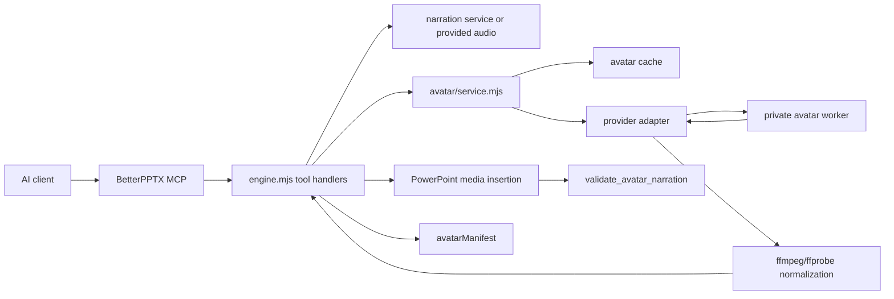

# BetterPPTX Avatar Generation Architecture

Last reverified: 2026-07-18.

This document explains the implemented BetterPPTX avatar narration topology:
how script, voice audio, LivePortrait/MuseTalk-style lipsync workers, ffmpeg,
PowerPoint media packaging, billing, cache, and validation fit together.

It is private implementation documentation. Do not copy it verbatim to public
BetterPPTX docs, because it names implementation files, environment variables,
deployment topology, and model-provider details that public endpoints must keep
black-box.

## Current State

The repository has an implemented avatar subsystem under
`betterpptx-mcp/avatar/`.

Implemented:

- MCP tools: `betterpptx.avatar.render_job`,
  `betterpptx.avatar.job_status`, `betterpptx.avatar.attach_result`,
  `betterpptx.slide.add_avatar_narration`,
  `betterpptx.deck.add_avatar_narration`, and
  `betterpptx.deck.validate_avatar_narration`.
- Provider adapters: `test-static`, `musetalk`, `liveportrait-musetalk`, and
  `sadtalker`.
- Local packaging verifier: `test-static` loops a presenter image over WAV
  audio with ffmpeg, then validates the exact PowerPoint media packaging path.
- Model-backed worker boundary: `musetalk` and `liveportrait-musetalk` call a
  private HTTP worker using enabled `avatar-worker` credential-store accounts
  (with the legacy single-account env fallback).
- PowerPoint normalization: all returned MP4s are transcoded to H.264,
  yuv420p, AAC, faststart and get a PNG poster frame.
- Avatar manifest and validator: avatar slides are tracked separately from
  narration audio and validated with video-specific checks.
- Billing and cache behavior: avatar is a standalone premium feature; render
  jobs finalize billing when a value is produced, and cache hits release the
  reservation as no-charge.
- Job durability boundary: when `BETTERPPTX_AVATAR_JOB_STORE` is configured,
  queued/running/terminal metadata is persisted locally or in Firestore with
  hashed session ownership and opaque video/poster handles. Raw media paths are
  never written to that record; records now carry `expiresAt` for TTL/purge
  enforcement. Durable worker dispatch, distributed purge, and recovery remain
  separate production gates.
- Durable dispatch bridge: when the shared operation ledger is enabled and an
  idempotency key is supplied, `avatar.render_job` enters the queued operation
  path. A durable worker waits for the avatar job to reach terminal state before
  acknowledging the operation. Local contract evidence now covers live-lease
  exclusion, expired-lease takeover/fencing, retry reclaim, and terminal
  completion; production Firestore lease recovery and worker idempotency are
  still required.
- Presenter execution boundary: the provider-neutral presenter contract now
  emits a per-slide execution plan choosing embedded talking-head media, native
  3D, hybrid, poster, audio-only, or absent. Static motion policy selects a
  poster when available. `presenter-runtime-director.mjs` lowers active choices
  against the compiled native PowerPoint operations and fails closed when an
  explicit lane has no executable operation. This is still not a playback
  claim; render/playback, identity-continuity, and quality evidence remain
  separate release gates.
- The private canary's playback contract is independently checked for MP4
  container/tracks, PowerPoint media/poster relationships, slide advance timing,
  and the existing COM-open result. Cross-platform playback and visual quality
  are intentionally not inferred from this package check.
- The local billing ledger contract also proves replay-safe reservation, commit,
  usage settlement, failure release, conflict rejection, and tenant isolation.
  This is a local correctness proof; Firestore/PayRam settlement and
  multi-instance reconciliation remain launch gates.
- Rotating worker selection now consults secret-free account health state: quota or
  transient failures create a cooldown, successful renders clear it, and a local
  contract proves the persisted state contains only account hashes. The local
  backend is research-only; Firestore state, weighted quota accounting, and owner
  rotation remain production gates.
- Avatar video/poster artifacts can use an opt-in tenant-scoped durable path over the
  content-addressed local/GCS store. The lifecycle contract verifies digest-checked
  rehydration, tenant isolation, and idempotent replay; the local backend is evidence
  only until production GCS, expiry scheduling, and billing reconciliation are live.

Representation boundary:

- `liveportrait-musetalk` is the talking-head narration-recording lane. It
  returns a rendered MP4 which BetterPPTX normalizes and embeds as
  PowerPoint-native media with audio, poster, captions, cues, timing, and
  validation.
- The editable native 3D presenter is a separate rigged-GLB/PowerPoint 3D
  lane. LivePortrait/MuseTalk does not produce an editable PowerPoint 3D
  object; the unified product contract chooses between the two representations
  or a safe fallback.

Not implemented in this repository:

- A checked-in LivePortrait or MuseTalk model worker image.
- Model checkpoints or model code.
- A Modal-specific deployment adapter. Modal can host the private worker, but it
  must expose the same HTTP contract described here. The current repo only
  stores Modal A10G as a measured pricing basis in billing/cost comments and
  plans.

## Design Principle

Avatar narration is downstream of narration audio.

The correct mental model is:

```text
AI-authored script
-> BetterPPTX resolves narration audio or accepts provided audio
-> avatar worker receives presenter image plus audio
-> worker returns raw talking-presenter MP4
-> BetterPPTX normalizes MP4 for PowerPoint
-> BetterPPTX embeds video, poster, timing, notes, captions, and cues
-> validator verifies PPTX package structure
```

The avatar worker is not the PowerPoint authoring engine. It does one job:
turn a still portrait plus narration audio into a talking-presenter MP4. The
MCP server owns everything else: deck state, tool surface, voice resolution,
privacy, billing, cache, ffmpeg normalization, PowerPoint insertion, validation,
download delivery, and public black-box behavior.

Use `kind:"narration"` or `slide.add_narration` when the slide needs spoken
audio only. Use avatar narration only when a visible presenter video is part of
the creative direction.

## Topology



Main implementation anchors:

| Layer | File |
| --- | --- |
| Tool schemas | `betterpptx-mcp/tools.mjs` |
| Tool handlers | `betterpptx-mcp/engine.mjs` |
| Avatar orchestration | `betterpptx-mcp/avatar/service.mjs` |
| Provider selection | `betterpptx-mcp/avatar/providers/index.mjs` |
| MuseTalk HTTP adapter | `betterpptx-mcp/avatar/providers/musetalkHttp.mjs` |
| LivePortrait/MuseTalk HTTP adapter | `betterpptx-mcp/avatar/providers/liveportraitMuseTalkHttp.mjs` |
| Async job queue | `betterpptx-mcp/avatar/jobs.mjs` |
| Durable job metadata | `betterpptx-mcp/storage/avatar-job-store.mjs` |
| Cache | `betterpptx-mcp/avatar/cache.mjs` |
| Artifact/path guards | `betterpptx-mcp/avatar/artifacts.mjs` |
| MP4 normalization | `betterpptx-mcp/avatar/ffmpeg.mjs` |
| Consent checks | `betterpptx-mcp/avatar/consent.mjs` |
| Package validator | `betterpptx-mcp/avatar/validate.mjs` |
| Worker compose profile | `betterpptx-mcp/deploy/avatar-compose.yml` |
| Cloud Run worker template | `betterpptx-mcp/deploy/cloud-run-avatar-worker.yaml` |
| Runtime verifier | `betterpptx-mcp/verify-avatar-runtime.mjs` |
| Presenter contract/execution plan | `betterpptx-mcp/ir/presenter-contract.mjs` |
| Presenter runtime lowering audit | `betterpptx-mcp/ir/presenter-runtime-director.mjs` |
| PPTX playback contract verifier | `betterpptx-mcp/verify-avatar-pptx-playback-contract.mjs` |
| Avatar metadata retention verifier | `betterpptx-mcp/verify-avatar-job-retention.mjs` |
| Avatar billing exactly-once verifier | `betterpptx-mcp/verify-avatar-billing-exactly-once.mjs` |
| Avatar worker health-state verifier | `betterpptx-mcp/verify-avatar-worker-state.mjs` |
| Avatar artifact lifecycle verifier | `betterpptx-mcp/verify-avatar-artifact-lifecycle.mjs` |
| Smoke tests | `betterpptx-mcp/smoke-avatar-narration.mjs`, `betterpptx-mcp/smoke-avatar-job.mjs` |

## Tool Paths

### Public model-backed path

Public model-backed avatar rendering should use the asynchronous job path:

```text
betterpptx.avatar.render_job
-> betterpptx.avatar.job_status
-> betterpptx.avatar.attach_result
-> betterpptx.deck.validate_avatar_narration
-> betterpptx.deck.save
```

`render_job` returns quickly with a job id. The in-process avatar queue then
renders with `BETTERPPTX_AVATAR_MAX_CONCURRENCY`. When the job succeeds,
`job_status` returns a public-safe video reference, and `attach_result` embeds
the finished MP4 into a slide.

The production-shaped template also configures the Firestore job-metadata
store. This makes status/attach rehydratable across instances once the worker
dispatch and shared asset stores are live; local mode is a development proof,
not a public-production substitute.

In public black-box mode, inline model-backed rendering is rejected with
`AVATAR_JOB_REQUIRED`; clients should start a job, poll it, then attach the
result.

### Inline path

`betterpptx.slide.add_avatar_narration` with `renderMode:"inline"` resolves
audio, renders video, normalizes, and embeds it in one call.

Inline rendering is appropriate for:

- `test-static` packaging smoke tests;
- short maintainer-local experiments;
- private development where timeouts and billing are controlled.

It is not the preferred public path for model-backed MuseTalk or
LivePortrait/MuseTalk rendering.

### Deck batch path

`betterpptx.deck.add_avatar_narration` loops through per-slide avatar narration
requests and calls the slide path. It is useful for local/private batch work,
but public clients should still prefer explicit render jobs for model-backed
videos so long-running work is visible and recoverable.

## Provider Modes

Provider selection is internal runtime configuration:

| Provider | Meaning | Requires |
| --- | --- | --- |
| `disabled` | Avatar rendering unavailable. | No worker. |
| `test-static` | Static presenter image plus audio packaged as MP4. | ffmpeg and ffprobe only. |
| `musetalk` | HTTP worker performs model-backed lipsync. | Private worker URL, token, model image/weights. |
| `liveportrait-musetalk` | HTTP worker performs advanced model-backed generation. | Private worker URL, token, reviewed model image/weights. |
| `sadtalker` | CLI/private worker model MVP. | Private reviewed runtime; not the public MCP image. |

Public tool schemas should expose product choices like quality, mode, script,
audio, and avatar image. They should not expose provider implementation ids,
model names, file paths, dependency names, or GPU class.

## Worker Contract

The model-backed worker must expose:

```text
POST /v1/avatar/lipsync
Authorization: Bearer <BETTERPPTX_AVATAR_WORKER_TOKEN>
Accept: video/mp4, application/json
Content-Type: multipart/form-data
```

Multipart fields:

| Field | Required | Meaning |
| --- | --- | --- |
| `image` | yes | Presenter portrait PNG/JPEG. |
| `audio` | yes | Narration WAV/M4A/MP3. |
| `quality` | yes | `fast`, `default`, or `quality`. |
| `mode` | yes | Internal worker mode, currently `musetalk` or `liveportrait-musetalk`. |
| `durationMs` | no | Expected audio duration in milliseconds. |
| `motionProfile` | no | Private allowlisted profile: `default`, `low`, `natural`, `mouth-only`, `balanced`, or `static`; controls the LivePortrait motion plate without exposing model CLI names. `natural` uses full-region motion at 0.45 with eye retargeting and MuseTalk as final mouth owner. |
| `mouthProfile` | no | Private allowlisted MuseTalk blend profile: `default` (jaw mask), `raw` (tight lip mask), `lower` (source upper-lip preservation), `aligned` (mask aligned to generated crop), or `warp` (full generated-crop geometric registration). `inner` and `raw-sharp` remain diagnostics only. |

The MCP forwards a caller idempotency key as `Idempotency-Key` when supplied.
Workers must deduplicate that key and expose cancellation/terminal semantics;
the gateway does not assume a timeout cancelled GPU work.

Supported response forms:

- raw `video/mp4` bytes;
- JSON with `videoBase64`;
- JSON with `mp4Base64`;
- JSON with `videoDataUri`;
- JSON with `downloadUrl` or `videoUrl` only when
  `BETTERPPTX_AVATAR_WORKER_ALLOW_RESULT_URLS=1`.

The worker should not return local paths, logs, dependency versions, source
locations, model checkpoint names, or stderr. The MCP adapter intentionally maps
worker failures to generic public avatar errors.

## Modal Worker Fit

There is no Modal-specific code path in this repo. To use Modal, deploy a Modal
web endpoint or web server that implements the worker contract above, then set:

```text
BETTERPPTX_AVATAR_PROVIDER=musetalk
BETTERPPTX_AVATAR_WORKER_URL=https://<modal-worker-origin>
BETTERPPTX_AVATAR_WORKER_ROUTE=/v1/avatar/lipsync
BETTERPPTX_AVATAR_WORKER_TOKEN=<secret>
```

Current Modal docs support web-exposed functions and GPU-backed functions. They
also document a hard HTTP request timeout for Web Functions; the current
BetterPPTX `musetalkHttp` provider expects one HTTP call to return the MP4
within the provider timeout. Therefore a Modal worker must either finish and
return the MP4 inside the Modal web request limit, or the provider must be
extended to speak a worker-side job/result contract. The BetterPPTX public MCP
`render_job` queue keeps the AI-facing tool call short, but it does not by
itself split the private worker's single HTTP request.

Useful Modal references for the worker implementer:

- [Modal Web Functions](https://modal.com/docs/guide/webhooks)
- [Modal GPU acceleration](https://modal.com/docs/guide/gpu)
- [Modal request timeouts](https://modal.com/docs/guide/webhook-timeouts)
- [Modal secrets](https://modal.com/docs/guide/secrets)

## Audio And Mode Semantics

Every avatar render needs audio:

- If `script` is provided, the MCP resolves TTS through the narration service.
- If `audio` is provided, the MCP accepts that media directly. Non-WAV external
  audio should include duration metadata when needed.

Avatar video modes:

| Mode | Packaging |
| --- | --- |
| `videoWithAudio` | Normalized MP4 keeps AAC audio; the slide plays the video. |
| `mutedVideoPlusNativeAudio` | Normalized MP4 has audio stripped; MCP embeds a separate hidden native PowerPoint audio object and plays it on the same timeline. |

`mutedVideoPlusNativeAudio` is useful when native PowerPoint audio behavior is
preferred, but it requires resolved narration audio at attach time.

## PowerPoint Package Invariants

After the worker returns raw MP4, the MCP must:

1. Normalize to PowerPoint-safe MP4:

   ```text
   ffmpeg -i raw.mp4 -c:v libx264 -pix_fmt yuv420p -c:a aac -b:a 160k -movflags +faststart avatar-powerpoint.mp4
   ```

   For muted mode, `-an` replaces AAC audio.

2. Verify with ffprobe that the media is safe and below
   `BETTERPPTX_AVATAR_MAX_SECONDS`.

3. Extract a PNG poster frame.

4. Pass the poster as a `data:image/png;base64,...` cover to
   `slide.addMedia({ type:"video" })`.

5. Add a media playback animation with `playFrom(0.0)`.

6. Set slide auto-advance timing so `advTm` is at least the avatar video
   duration plus requested padding and any cue/caption tail.

7. Record `entry.avatarManifest`, not `entry.narrationManifest`.

8. Validate with `betterpptx.deck.validate_avatar_narration`.

The avatar validator checks:

- `[Content_Types].xml` has MP4 content type;
- each avatar slide has `a:videoFile`, `p14:media`, `p:video`, and a media
  `playFrom(0.0)` command;
- slide rels include both video and media relationships;
- the poster image relationship points to a PNG;
- `advClick="0"` and `advTm` are present;
- `advTm` is not shorter than the avatar duration recorded in the manifest.

## Cache And Artifacts

Avatar render cache keys include:

- audio hash;
- avatar image hash;
- script hash;
- provider;
- quality;
- mode;
- PowerPoint normalization profile.

The cache stores normalized MP4, poster PNG, metadata, video hash, and duration.
When a cache hit satisfies a paid render request, billing reservation is
released as no-charge.

Artifact and cache controls:

```text
BETTERPPTX_AVATAR_CACHE_DIR
BETTERPPTX_AVATAR_CACHE_MAX_MB
BETTERPPTX_AVATAR_CACHE_TTL_MS
BETTERPPTX_AVATAR_JOB_TTL_MS
BETTERPPTX_AVATAR_JOB_MAX_MB
BETTERPPTX_AVATAR_MAX_JOBS
```

Uploaded avatar image data is bounded by `BETTERPPTX_AVATAR_MAX_PAYLOAD_MB`.
Maintainer-local image paths must stay under allowed directories from
`BETTERPPTX_ALLOWED_AVATAR_DIRS` or the default output/cache roots.

## Billing And Access

Avatar rendering is standalone premium:

```text
betterpptx.avatar.render_job
betterpptx.slide.add_avatar_narration
betterpptx.deck.add_avatar_narration
```

Billing estimates are based on predicted or known duration, with an avatar
quality multiplier for high-quality requests. For async avatar jobs, the
reservation is passed into the job and finalized only after the job produces
video. Failed jobs release the reservation. Cache hits release the reservation
as no-charge.

Do not make model-backed avatar rendering available to public/free users without
an active billing gate. Avatar render cost is incurred at render time, not only
at deck save time.

## Consent And Licensing

Uploaded presenter images require:

```json
{
  "source": "uploaded",
  "image": { "data": "data:image/png;base64,..." },
  "consentAffirmed": true
}
```

The MCP logs a hashed consent affirmation for uploaded images. Public results
must not expose raw image hashes, local paths, worker internals, or model
details.

Before production model-backed use, the worker image and weights must have a
license review. This includes MuseTalk, LivePortrait, SadTalker, face detection,
face parsing, restoration/enhancer models, and any bundled checkpoints.

## Black-Box Requirements

Public endpoints must describe standard presentation capabilities and return
opaque handles or download URLs. They must not expose:

- source code;
- repository paths;
- local filesystem paths;
- process metadata;
- dependency names;
- provider names or model names;
- GPU class;
- logs or stderr;
- secret names or raw secrets.

The public vocabulary guard treats `liveportrait`, `musetalk`, `a10g`,
`piper-tts`, `libvips`, and similar engine-identifying tokens as forbidden in
engine-controlled structural package parts. User-authored slide content may
legitimately discuss those terms and is not blocked by that guard.

## Environment Wiring

Minimum local packaging smoke:

```text
BETTERPPTX_AVATAR_PROVIDER=test-static
BETTERPPTX_FFMPEG_PATH=ffmpeg
BETTERPPTX_FFPROBE_PATH=ffprobe
BETTERPPTX_PREMIUM=1
```

Container defaults:

```text
BETTERPPTX_FFMPEG_PATH=/usr/bin/ffmpeg
BETTERPPTX_FFPROBE_PATH=/usr/bin/ffprobe
BETTERPPTX_AVATAR_PROVIDER=test-static
BETTERPPTX_AVATAR_MAX_CONCURRENCY=1
BETTERPPTX_AVATAR_MAX_SECONDS=120
BETTERPPTX_AVATAR_TIMEOUT_MS=600000
BETTERPPTX_AVATAR_CACHE_DIR=/var/lib/betterpptx/avatar
```

Model-backed HTTP worker:

```text
BETTERPPTX_AVATAR_PROVIDER=musetalk
BETTERPPTX_AVATAR_WORKER_URL=https://PRIVATE-WORKER-URL
BETTERPPTX_AVATAR_WORKER_ROUTE=/v1/avatar/lipsync
BETTERPPTX_AVATAR_WORKER_TOKEN=<secret>
BETTERPPTX_AVATAR_MAX_CONCURRENCY=1
BETTERPPTX_AVATAR_TIMEOUT_MS=600000
```

Use `liveportrait-musetalk` only when the private worker actually supports that
mode and its dependencies/models have been approved.

## Verification Ladder

Run from the repository root unless noted.

### 1. Runtime binary check

```powershell
node betterpptx-mcp\verify-avatar-runtime.mjs --render-test-static
```

This verifies ffmpeg, ffprobe, static avatar video creation, MP4 normalization,
poster extraction, and PowerPoint-safe media probing.

Add TTS and worker checks when those services are configured:

```powershell
node betterpptx-mcp\verify-avatar-runtime.mjs --render-test-static --check-tts --check-worker-health
```

### 2. Inline packaging smoke

```powershell
$env:BETTERPPTX_AVATAR_PROVIDER="test-static"
$env:BETTERPPTX_PREMIUM="1"
$env:BETTERPPTX_ALLOW_PRIMITIVE_TOOLS="1"
$env:BETTERPPTX_AVATAR_SMOKE_ALLOW_UNAVAILABLE="0"
node betterpptx-mcp\smoke-avatar-narration.mjs
```

Expected result: a saved PPTX under `outputs/avatar-smoke/` and
`validate_avatar_narration` returns `ok:true`.

### 3. Async job smoke

```powershell
$env:BETTERPPTX_AVATAR_PROVIDER="test-static"
$env:BETTERPPTX_PREMIUM="1"
$env:BETTERPPTX_ALLOW_PRIMITIVE_TOOLS="1"
$env:BETTERPPTX_AVATAR_SMOKE_ALLOW_UNAVAILABLE="0"
node betterpptx-mcp\smoke-avatar-job.mjs
```

Expected result: `render_job` reaches `succeeded`, `attach_result` embeds the
video, and `validate_avatar_narration` returns `ok:true`.

`BETTERPPTX_ALLOW_PRIMITIVE_TOOLS=1` is required for these white-box smoke
scripts because the default AI-facing interface is json-spec only. The spec
compiler can still use primitive handlers internally; this override is only for
low-level verifier scripts that call primitive tools directly.

### 4. Docker compose packaging smoke

```powershell
docker compose up -d --build mcp-server piper-tts
docker compose exec -T mcp-server node betterpptx-mcp/verify-avatar-runtime.mjs --render-test-static --check-tts
```

### 5. Model-backed worker smoke

Configure:

```powershell
$env:BETTERPPTX_AVATAR_PROVIDER="musetalk"
$env:BETTERPPTX_AVATAR_WORKER_URL="https://PRIVATE-WORKER-URL"
$env:BETTERPPTX_AVATAR_WORKER_ROUTE="/v1/avatar/lipsync"
$env:BETTERPPTX_AVATAR_WORKER_TOKEN="<secret>"
$env:BETTERPPTX_PREMIUM="1"
```

Then run:

```powershell
node betterpptx-mcp\verify-avatar-runtime.mjs --check-worker-health
node betterpptx-mcp\smoke-avatar-job.mjs
```

For public endpoint validation, also run:

```powershell
node betterpptx-mcp\verify-blackbox-public.mjs https://YOUR-MCP-URL/mcp
```

### 6. Manual PowerPoint inspection

Open the saved smoke deck in PowerPoint and verify:

- no repair prompt;
- video poster is visible;
- slide advances after the avatar timing;
- captions and cue animations appear at the expected time;
- video audio is present in `videoWithAudio`, or separate native audio works in
  `mutedVideoPlusNativeAudio`.

## AI Wiring Checklist

When an AI needs to wire or verify avatar generation:

1. Confirm whether the request needs a visible presenter. If not, use narration
   audio only.
2. Confirm ffmpeg and ffprobe are available in the MCP runtime.
3. Start with `BETTERPPTX_AVATAR_PROVIDER=test-static` and pass the runtime and
   smoke verifiers.
4. Configure the private worker URL, route, token, duration cap, and concurrency.
5. Verify the worker contract independently with a short image+audio request.
6. Switch to `musetalk` or `liveportrait-musetalk`.
7. Use `avatar.render_job` for public/model-backed renders.
8. Poll `avatar.job_status` until `succeeded`.
9. Attach with `avatar.attach_result`.
10. Run `deck.validate_avatar_narration`.
11. Save the deck and run black-box validation for public endpoints.
12. Inspect the package or open in PowerPoint before claiming production
    readiness.

## Common Failures

| Symptom | Likely cause | Fix |
| --- | --- | --- |
| `AVATAR_UNAVAILABLE` | Provider disabled, worker URL missing, worker failed, or ffmpeg missing. | Configure provider/worker or run `test-static` verifier. |
| `MEDIA_PROBE_FAILED` | ffprobe missing or returned media is malformed. | Install ffprobe and inspect worker output privately. |
| `MEDIA_NORMALIZE_FAILED` | ffmpeg could not transcode returned media. | Ensure worker returns readable MP4 and duration is within cap. |
| `AVATAR_CONSENT_REQUIRED` | Uploaded image missing `consentAffirmed:true`. | Require explicit user consent or use default presenter. |
| `AVATAR_JOB_REQUIRED` | Public black-box model-backed inline render attempted. | Use `render_job` plus `job_status` plus `attach_result`. |
| `AVATAR_JOB_NOT_READY` | Attach called before job success. | Continue polling. |
| Validator missing video/media relationships | Bypassed `slide.addMedia` or patched ZIP manually. | Use the existing media insertion path; do not post-process PPTX ZIPs as a product fix. |
| Modal worker times out | Worker did not return MP4 inside Modal's web request limit. | Shorten clips, warm/cache models, or extend the provider to a worker-side job/result protocol. |

## Production Readiness Definition

Avatar generation is ready for public production only when all of these are
true:

- `test-static` smoke passes in the runtime image.
- Model-backed worker image and weights are privately reviewed and deployable.
- Private worker exposes the documented HTTP contract.
- Worker authentication is secret-managed and owner-rotatable.
- `render_job`/`job_status`/`attach_result` works end to end.
- `deck.validate_avatar_narration` returns `ok:true`.
- Saved PPTX opens in PowerPoint without repair.
- Public black-box verification passes.
- Billing gate charges or reserves at render time.
- Cache hits are no-charge and do not rerender.
- Uploaded presenter image consent is enforced.
- No public schema, result, health route, artifact metadata, or package
  structural part leaks model/provider/dependency/source internals.
